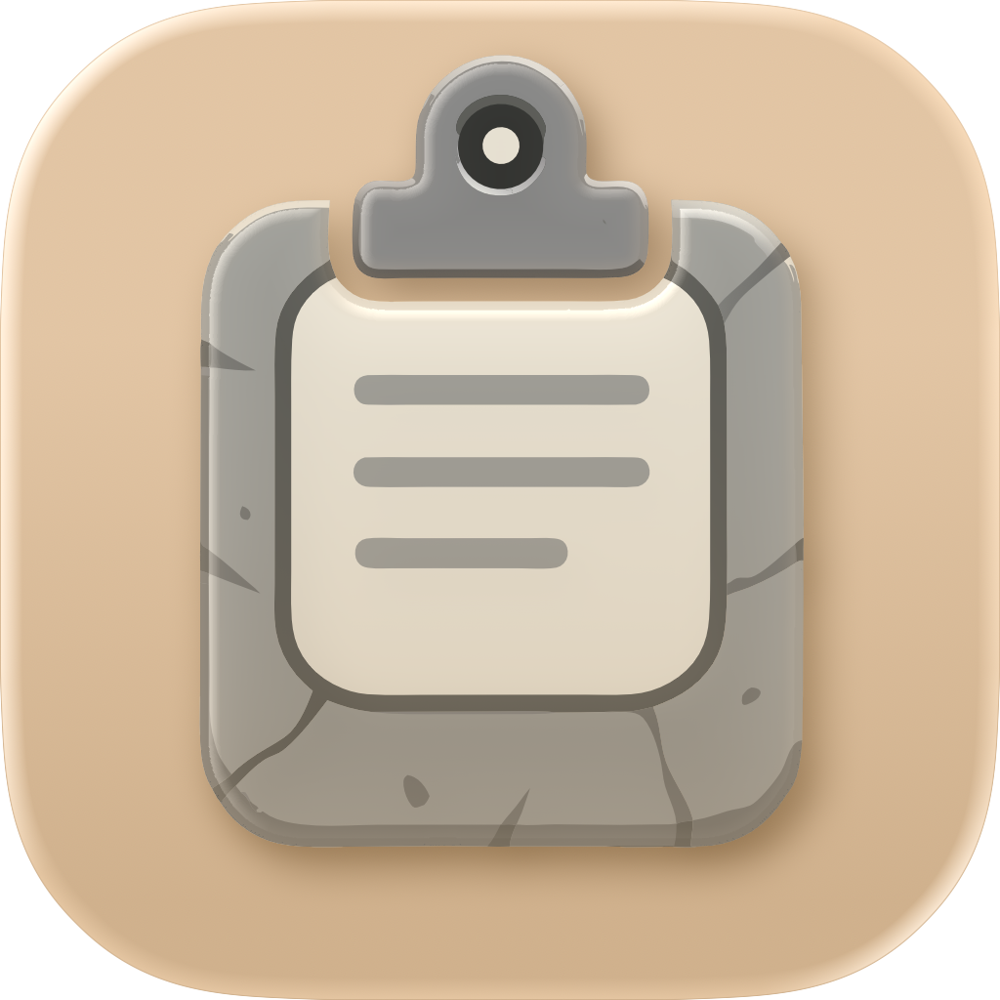
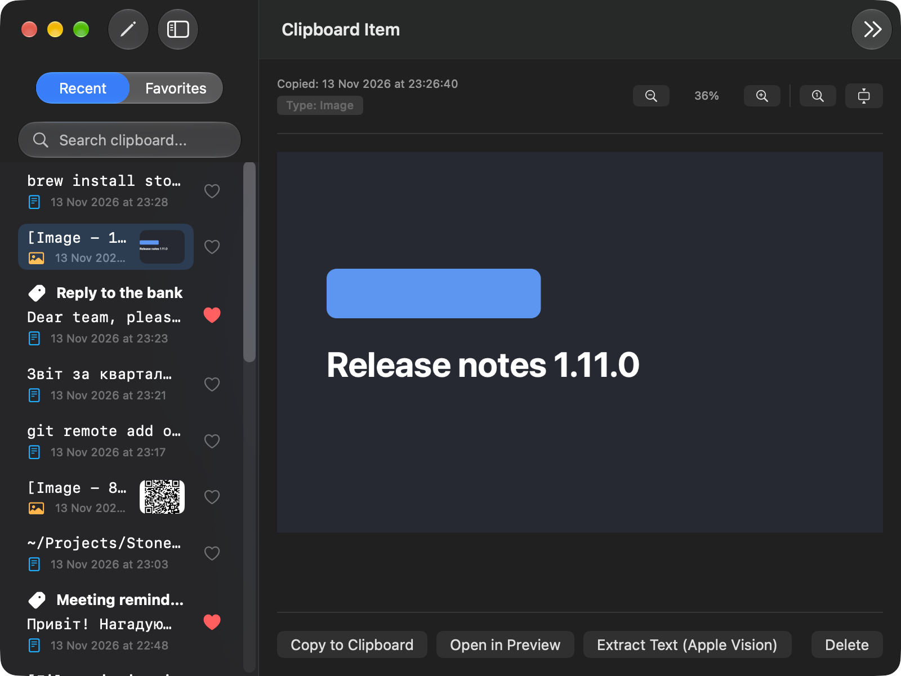
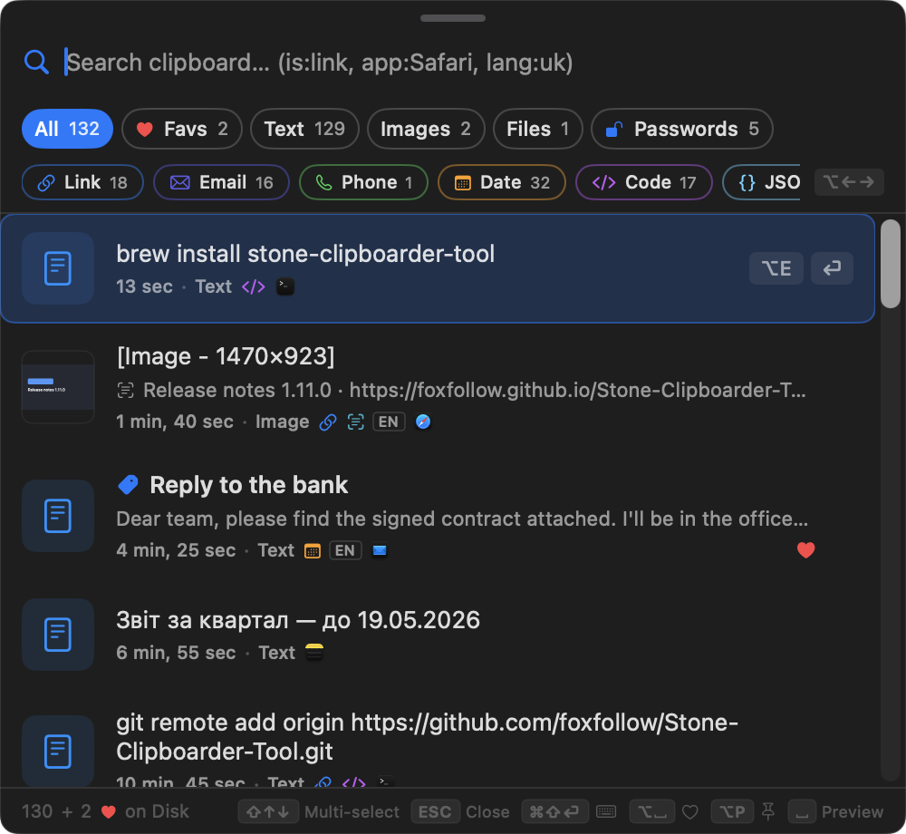
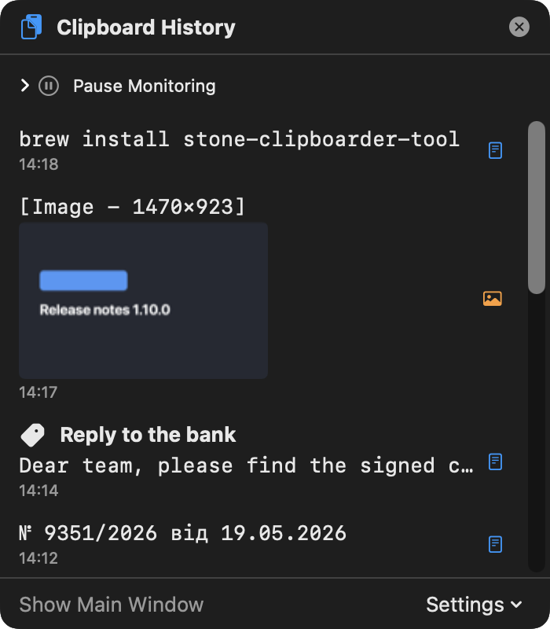

# Stone Clipboarder Tool

<div align="leading">

[](https://github.com/foxfollow/Stone-Clipboarder-Tool/actions/workflows/codeql.yml)
[](https://sonarcloud.io/summary/new_code?id=foxfollow_Stone-Clipboarder-Tool)

 <br>


</div>

<div align="center">



</div>

**Never lose anything you copy again.** Stone Clipboarder Tool is a free, open-source clipboard manager for macOS that automatically saves your entire copy-paste history. Access previously copied text and images instantly with global hotkeys, a Spotlight-like Quick Picker, or menu bar—all while keeping your data 100% private and stored locally on your device.

## Links

- **Live Preview**: [Visit site on GitHub Pages](https://foxfollow.github.io/Stone-Clipboarder-Tool/)
- **Latest Release**: [Download from GitHub](https://github.com/foxfollow/Stone-Clipboarder-Tool/releases/latest)
- **Installation Guide**: [Step-by-step installation instructions](https://foxfollow.github.io/Stone-Clipboarder-Tool/installation)


## Installation

### Homebrew (macOS)
```bash
brew tap foxfollow/stone
brew trust foxfollow/stone
brew install stone-clipboarder-tool
```

Newer Homebrew refuses to load casks from untrusted third-party taps (`Refusing to load cask ... from untrusted tap`), so `brew trust` is needed once after tapping. The app will be automatically configured to run without security warnings.

[Homebrew tap](https://github.com/foxfollow/homebrew-stone)

### Manual Download
Download the latest `.zip` from [Releases](https://github.com/foxfollow/Stone-Clipboarder-Tool/releases)

If macOS blocks the app on first launch (common for non-App Store apps):
```bash
xattr -d com.apple.quarantine /Applications/StoneClipboarderTool.app
```
*See the [Installation Guide](https://foxfollow.github.io/Stone-Clipboarder-Tool/installation) for detailed steps.*

## Features

### 🆕 New in Version 1.10.0
- **🪟 Categories**: A row of chips in the Quick Picker under the tabs groups items by what they contain — links, emails, phone numbers, addresses, dates, code, JSON, file paths and languages. ⌥← / ⌥→ switch between chips; ⇧-click or ⌥⇧← / ⌥⇧→ select several
- **🪟 Image Categories**: On the Images tab, Apple Vision finds text, QR codes and barcodes, faces and transparent areas, in the background and on your Mac. Text read from a screenshot counts for links, emails, languages and your own rules too
- **🪟 Searchable Image Text**: New screenshots and copied images are read once right after the copy, older ones when you choose "Recognize Text in All Images" in Settings, and your own OCR (⌥⏎, Extract Text) is kept too. Searching a word finds the picture, and the Quick Picker shows its text under the image
- **✨ Custom Categories**: Regular-expression rules (with a live test) and groups of source apps. Settings → Categories gives any category an SF Symbol or an emoji and a color, switches built-ins off, and sets Contains or Entire text matching
- **✨ Source App**: The app you copied from is remembered and shown as a small icon on the row. Turn it off or forget recorded apps in Settings → Categories
- **⌨️ Search Filters**: The Quick Picker's search takes is:link, is:fav, app:Safari, lang:uk — on their own or together with text
- **🎨 Row Badges**: Quick Picker rows show the icons of their categories, the language and the source app; Settings → Categories turns the icons and the image text off

**📖 [See the full changelog →](https://foxfollow.github.io/Stone-Clipboarder-Tool/version-history.html)**

### Core Features
- **Automatic Clipboard Monitoring**: Captures everything you copy while the app is running
- **Clipboard Capture Modes**: Choose to capture only text, only images, or both (useful for Microsoft Word text-only paste)
- **OCR Text Recognition**: Extract text from images using Apple Vision framework (Added in v1.2.0)
- **Combined Clipboard Items**: Save text and image as a single item (BETA - Added in v1.2.0)
- **Global Hotkeys**: System-wide keyboard shortcuts for instant clipboard access (⌃⌥1-0, ⌃⇧1-0)
- **Quick Picker Window**: Spotlight-like floating panel (⌃⌥Space) for fast item selection
- **Favorites System**: Keep frequently-used items; favorites are never auto-deleted. Reorder them with ⌥E in the Quick Picker
- **Item Titles**: Name any item (⌥E in the Quick Picker) so items that start the same way are easy to tell apart
- **Categories**: The Quick Picker sorts items into chips: links, emails, phone numbers, addresses, dates, code, JSON, file paths, languages, text/QR codes/faces/transparency in images (Apple Vision, and the text in images is searchable), your own regex rules and groups of source apps. ⌥←/⌥→ switch chips (⇧ for several); `is:link`, `app:Safari` and `lang:uk` work in the search field. Icons, colors and on/off in Settings → Categories; detection runs on your Mac
- **Pinned Windows**: Pin any item to the screen as a floating, always-on-top window (⌃⌥P pins the latest item)
- **Type-Out Paste**: ⌘⇧Return in the Quick Picker types text key by key, for fields and remote desktops that block pasting
- **Menu Bar Integration**: Quick access to your most recent items (5–50, configurable) from the menu bar
- **Native Settings**: Access settings through macOS app menu (⌘,) or menu bar
- **Persistent Storage**: Uses SwiftData to store clipboard history locally
- **Easy Access**: Browse and search your clipboard history in a clean interface
- **Quick Copy**: Click any item to copy it back to your clipboard
- **Smart Timestamp Update**: Reused items move to the top with updated timestamp
- **Smart Deduplication**: Copying something that's already in your history moves it to the top instead of saving it twice
- **Bulk Operations**: Delete all clipboard history with confirmation dialog
- **Flexible UI Options**: Show/hide main window and menu bar independently

## How It Works

1. **Start the app** - Clipboard monitoring begins automatically
2. **Copy anything** - Text copied to your clipboard is automatically saved
3. **Browse history** - View all your clipboard items in chronological order
4. **Reuse content** - Click any item to copy it back to your clipboard
5. **Manage items** - Delete unwanted items using the edit mode

## Interface

### App Screenshots

<table>
  <tr>
    <td align="center">
      <br>
      <sub><b>Main Window</b><br>Clipboard history with preview</sub>
    </td>
    <td align="center">
      <br>
      <sub><b>Quick Picker</b><br>Spotlight-like access (⌃⌥Space)</sub>
    </td>
    <td align="center">
      <br>
      <sub><b>Menu Bar</b><br>Quick access to recent items</sub>
    </td>
  </tr>
</table>

### Main Window
- **Left Panel**: List of all clipboard items with preview and timestamp
- **Right Panel**: Detailed view of selected item with copy/delete actions
- **Toolbar**: Settings, edit mode toggle, and manual add button
- **Status Indicator**: Green dot shows clipboard monitoring is active

### Menu Bar
- **Quick Access**: Shows last 10 clipboard items
- **One-Click Copy**: Click any item to copy and move it to the top
- **Settings Menu**: Toggle main window and menu bar visibility
- **Direct Actions**: Show main window or quit from menu bar

## Usage Tips

- Items are automatically saved when you copy text from any application
- The most recent items appear at the top
- Use the search bar to quickly find specific clipboard items
- Use the monospaced font preview to quickly identify content
- Delete unwanted items by enabling edit mode
- The app continues monitoring clipboard changes while it's running
- Exclude sensitive apps like password managers in Settings > Excluded Apps (v1.3.0+)
- Filter the Quick Picker by what an item is or where it came from: pick a chip (⌥←/⌥→) or type `is:code`, `app:Telegram`, `lang:en` in the search field
- Pause monitoring temporarily when working with sensitive data (v1.3.0+)

## Requirements

- macOS 15.0+
- Xcode 26+ (for building from source: the project uses an Icon Composer app icon and macOS 26 APIs behind availability checks)

## Building

1. Open `StoneClipboarderTool.xcodeproj` in Xcode
2. Build and run the project
3. Grant Accessibility permission when asked (needed to paste into other apps)

The app uses SwiftUI and SwiftData for a modern, native macOS experience.

Unit tests run inside the app but against in-memory stores and throwaway settings, so they never touch your real history:

```bash
xcodebuild test -project StoneClipboarderTool.xcodeproj -scheme StoneClipboarderTool -destination "platform=macOS"
```

`make screenshots` re-renders the landing page screenshots from the app's real views with made-up data.

Manual checks per feature are in [TESTING_GUIDE.md](TESTING_GUIDE.md); contributor and agent notes are in [AGENTS.md](AGENTS.md) and [docs/CODEMAP.md](docs/CODEMAP.md).

## Version History

[View Full Version History](https://foxfollow.github.io/Stone-Clipboarder-Tool/version-history.html)

## License
The MIT License (MIT)

Copyright © 2025 Heorhii Savoiskyi d3f0ld@proton.me